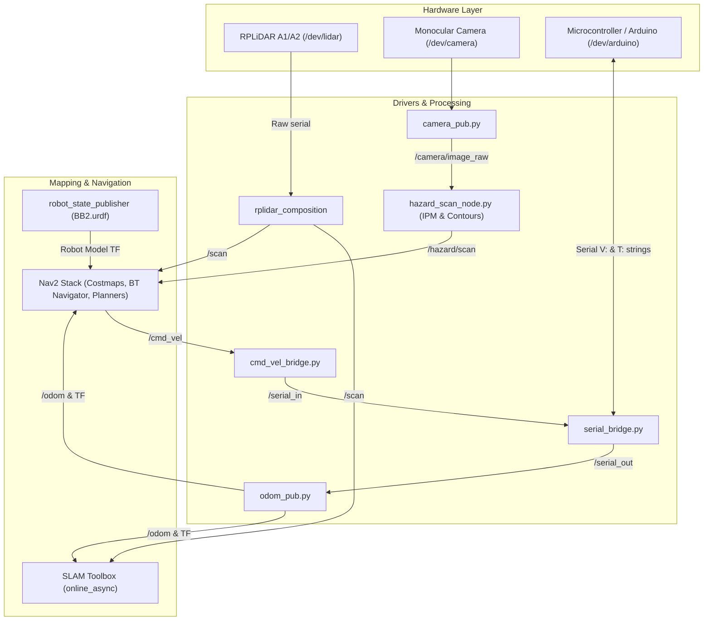
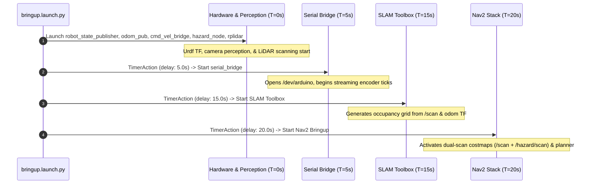

# Hazard-Aware Mobile Robot (HAR) using Nav2 & SLAM

An autonomous differential-drive mobile robot system developed in **ROS 2** that enhances traditional 2D LiDAR navigation by integrating **vision-based ground hazard detection**. Ground-level obstacles, floor transitions, debris, and low-profile objects undetected by planar LiDAR are identified via monocular computer vision, projected onto the ground plane using Inverse Perspective Mapping (IPM), and injected as a virtual laser scan into the **Nav2** local costmap for dynamic collision avoidance.

---

## Table of Contents

- [Overview](#overview)
- [System Architecture](#system-architecture)
- [Workspace Packages](#workspace-packages)
- [Main Launch File: `bringup.launch.py`](#main-launch-file-bringuplaunchpy)
- [Hardware Specifications & Kinematics](#hardware-specifications--kinematics)
- [Vision-Based Hazard Detection](#vision-based-hazard-detection)
- [Installation & Build](#installation--build)
- [Hardware & Udev Setup](#hardware--udev-setup)
- [Running the Robot](#running-the-robot)
- [ROS 2 Interfaces & TF Tree](#ros-2-interfaces--tf-tree)
- [Troubleshooting](#troubleshooting)

---

## Overview

Traditional 2D LiDAR planar scanners are mounted at a fixed height and can only sense obstacles across a single 2D horizontal plane. Low-profile obstacles, cords, steps, toys, or floor-level debris fall below the LiDAR scan plane and are invisible to standard mapping and navigation.

The **Hazard-Aware Mobile Robot (HAR)** solves this by coupling:
1. **Physical RPLiDAR A1/A2**: 360° obstacle sensing and mapping on `/scan`.
2. **Ground Hazard Vision Perception (`har_perception`)**: Real-time monocular image processing, edge/glare filtering, contour evaluation, temporal tracking, and ground projection that synthesizes a virtual obstacle scan on `/hazard/scan`.
3. **Dual-Source Nav2 Local Costmap**: Merges physical LiDAR scans with the vision hazard scan to generate inflation and obstacle layers, enabling the robot to route around both tall obstacles and low ground hazards.



---

## System Architecture

The robot system is structured across 6 ROS 2 packages:

| Package | Role | Description |
|---|---|---|
| **`har_bringup`** | **Orchestration & Startup** | Houses the central system launch file (`bringup.launch.py`) that coordinates all hardware, perception, SLAM, and Nav2 nodes with staggered startup delays. |
| **`har_description`** | **Robot Model & Kinematics** | Contains the SolidWorks-exported robot model (`BB2.urdf`), STL meshes, joints, and launch files for `robot_state_publisher`. |
| **`har_hardware`** | **Hardware Drivers & Odometry** | Implements the serial bridge to the motor controller, differential drive kinematics converter (`cmd_vel_bridge.py`), odometry calculator (`odom_pub.py`), and camera publisher (`camera_pub.py`). |
| **`har_perception`** | **Hazard Detection & Vision** | Monocular ground-hazard detection node (`hazard_scan_node.py`), inverse perspective mapping, temporal IoU tracker, lens calibration data, and vision filters. |
| **`har_slam`** | **Simultaneous Localization & Mapping** | Configured `slam_toolbox` asynchronous online SLAM (`mapper_params_online_async.yaml`) generating 2D occupancy grids and publishing `map -> odom` transform. |
| **`har_navigation`** | **Autonomous Path Planning** | Configured `nav2_params.yaml` incorporating dual observation sources (`/scan` and `/hazard/scan`) into the local costmap, controller server, planner, and behavior trees. |

---

## Main Launch File: `bringup.launch.py`

The main entry point for the entire robot system is:

```bash
ros2 launch har_bringup bringup.launch.py
```

> [!IMPORTANT]
> **Primary Launch Target**: `har_bringup/launch/bringup.launch.py` is the only production launch file intended for running the complete robot system. Other launch files within `har_bringup` (`navslam.launch.py`, `script.launch.py`) were test-only prototypes and should be ignored.

### Launch Sequence & Staggered Timing

Because sensor drivers, serial interfaces, and transform broadcasters require time to initialize before higher-level mapping and navigation nodes can resolve coordinates, `bringup.launch.py` implements a staged launch sequence using `TimerAction`:



1. **Immediate (T = 0.0s)**:
   - `robot_state_publisher`: Publishes static robot geometry and link transforms from `BB2.urdf`.
   - `odom_pub`: Prepares odometry calculation and initializes the `odom -> base_footprint` TF frame.
   - `cmd_vel_bridge`: Differential drive conversion node listening to `/cmd_vel`.
   - `hazard_node`: Vision detection node listening to camera images and calculating ground projections.
   - `rplidar_composition`: Starts RPLiDAR driver on `/dev/lidar`, streaming `/scan`.
2. **Serial Initialization (T = 5.0s)**:
   - `serial_bridge`: Opens `/dev/arduino` (115200 baud). Delay ensures ROS topic publishers/subscribers are fully registered before high-frequency serial streaming starts.
3. **SLAM Initialization (T = 15.0s)**:
   - Launches `har_slam/launch/slam.launch.py` with `mapper_params_online_async.yaml`. Delay guarantees steady odometry and laser scan availability.
4. **Nav2 Navigation Stack (T = 20.0s)**:
   - Launches `har_navigation/launch/navigation.launch.py` with `nav2_params.yaml`. Delay guarantees that SLAM has established the `map -> odom` transform and initialized the initial map.

### Launch Arguments

You can override default parameters when launching `bringup.launch.py`:

| Argument | Default Value | Description |
|---|---|---|
| `use_sim_time` | `false` | Set to `true` when testing against Gazebo simulation. |
| `urdf_file` | `BB2.urdf` | Name of the URDF robot description file in `har_description/urdf/`. |
| `slam_params_file` | `mapper_params_online_async.yaml` | Path to the SLAM Toolbox configuration file. |
| `nav2_params_file` | `nav2_params.yaml` | Path to the Nav2 parameters YAML in `har_navigation/config/`. |
| `slam_delay` | `15.0` | Delay in seconds before launching SLAM Toolbox. |
| `nav2_delay` | `20.0` | Delay in seconds before launching Nav2. |

Example running with custom delays:
```bash
ros2 launch har_bringup bringup.launch.py slam_delay:=10.0 nav2_delay:=15.0
```

---

## Hardware Specifications & Kinematics

### Physical Robot Dimensions
- **Drive Type**: Two-wheel differential drive with passive casters.
- **Wheel Separation (Track Width)**: `0.185 m` (185 mm).
- **Wheel Radius**: `0.033 m` (33 mm, 66 mm wheel diameter).
- **Encoder Resolution**: `2340.0` ticks per full wheel revolution.
- **Camera Mount**: Forward-facing at `0.17 m` height above ground with `15.0°` downward pitch.

### Microcontroller Serial Protocol
The ROS host communicates with the Arduino motor controller over USB serial (`/dev/arduino` @ 115200 baud):

1. **Velocity Commands (ROS -> Arduino)**:
   - Topic: `/serial_in` (published by `cmd_vel_bridge.py`)
   - Format: `T:<left_ticks_per_sec>,<right_ticks_per_sec>\n`
   - Example: `T:450.25,-450.25`
2. **Wheel Encoder Telemetry (Arduino -> ROS)**:
   - Topic: `/serial_out` (read by `serial_bridge.py` and processed by `odom_pub.py`)
   - Format: `V:<left_ticks_per_sec>,<right_ticks_per_sec>\n`
   - Example: `V:448.10,-447.80`

### Odometry & Kinematics Calculation
- `odom_pub.py` converts wheel tick velocities into metric velocity:
  $$v_{\text{left}} = \text{ticks/s} \times \frac{2\pi \cdot r_{\text{left}}}{\text{TICKS\_PER\_REV}}$$
  $$v = \frac{v_{\text{right}} + v_{\text{left}}}{2}, \quad \omega = \frac{v_{\text{right}} - v_{\text{left}}}{\text{WHEEL\_SEPARATION}}$$
- Publishes:
  - `nav_msgs/msg/Odometry` on `/odom`
  - `sensor_msgs/msg/JointState` on `/joint_states` (joints `j1` and `j2`)
  - TF transform: `odom -> base_footprint`

---

## Vision-Based Hazard Detection

The package `har_perception` runs `hazard_scan_node.py` which extracts obstacles from the ground plane:

```
[Camera Image]
      │
      ▼
[Lens Undistortion (K, D matrices)]
      │
      ▼
[Horizon Cutoff ROI (excludes ceiling/walls based on camera pitch)]
      │
      ▼
[Median Blur + Canny Edge Detection + Glare Suppression]
      │
      ▼
[Morphological Closing + Contour Extraction + Floor Transition Filter]
      │
      ▼
[Temporal Box Filter (IoU tracking across frames to eliminate jitter)]
      │
      ▼
[Inverse Perspective Mapping (Ground Contact (u, v) -> Metric (x, y))]
      │
      ▼
[Virtual sensor_msgs/LaserScan published on /hazard/scan]
```

### Nav2 Costmap Integration
In `har_navigation/config/nav2_params.yaml`, the Nav2 `local_costmap` is configured with multiple observation sources:

```yaml
local_costmap:
  local_costmap:
    ros__parameters:
      obstacle_layer:
        enabled: true
        observation_sources: scan hazard_scan
        scan:
          topic: /scan
          data_type: "LaserScan"
          marking: true
          clearing: true
        hazard_scan:
          topic: /hazard/scan
          data_type: "LaserScan"
          marking: true
          clearing: true
```

When an obstacle appears on the floor in front of the camera, `hazard_scan_node.py` computes its metric ground footprint and marks cells directly into the Nav2 obstacle layer, preventing collisions before the robot approaches.

---

## Installation & Build

### Prerequisites
- **OS**: Ubuntu 24.04 LTS (or Ubuntu 22.04 LTS)
- **ROS 2**: Jazzy Jalisco (or Humble Hawksbill)
- **Hardware Drivers & Dependencies**:
  ```bash
  sudo apt update
  sudo apt install -y \
      ros-$ROS_DISTRO-navigation2 \
      ros-$ROS_DISTRO-nav2-bringup \
      ros-$ROS_DISTRO-slam-toolbox \
      ros-$ROS_DISTRO-rplidar-ros \
      ros-$ROS_DISTRO-robot-state-publisher \
      ros-$ROS_DISTRO-cv-bridge \
      ros-$ROS_DISTRO-tf2-ros \
      python3-serial \
      python3-opencv \
      python3-numpy \
      python3-yaml
  ```

### Build Workspace
Clone or place the repository inside your ROS 2 workspace `src/` directory:

```bash
# Create ROS 2 workspace
mkdir -p ~/har_ws/src
cd ~/har_ws/src

# Clone the repository
git clone https://github.com/hmnt-zy/hazard-aware-mobile-robot.git

# Build packages
cd ~/har_ws
colcon build --symlink-install

# Source setup
source ~/har_ws/install/setup.bash
```

---

## Hardware & Udev Setup

To prevent serial port name collisions (`/dev/ttyUSB0`, `/dev/ttyUSB1`, `/dev/video0`), persistent udev rules are recommended for the Arduino, RPLiDAR, and Camera.

1. Find device Vendor ID and Product ID:
   ```bash
   lsusb
   ```
2. Create `/etc/udev/rules.d/99-har.rules`:
   ```bash
   sudo nano /etc/udev/rules.d/99-har.rules
   ```
3. Add rules mapping your devices (adjust `idVendor` and `idProduct` to match your devices):
   ```udev
   # RPLiDAR USB device -> /dev/lidar
   KERNEL=="ttyUSB*", ATTRS{idVendor}=="10c4", ATTRS{idProduct}=="ea60", MODE:="0666", SYMLINK+="lidar"

   # Arduino / Motor Controller -> /dev/arduino
   KERNEL=="ttyACM*" OR KERNEL=="ttyUSB*", ATTRS{idVendor}=="2341", ATTRS{idProduct}=="0043", MODE:="0666", SYMLINK+="arduino"

   # USB Camera -> /dev/camera
   KERNEL=="video*", ATTRS{idVendor}=="0c45", ATTRS{idProduct}=="6366", MODE:="0666", SYMLINK+="camera"
   ```
4. Reload udev rules and replug devices:
   ```bash
   sudo udevadm control --reload-rules
   sudo udevadm trigger
   sudo usermod -aG dialout,video $USER
   ```

---

## Running the Robot

### 1. Launch Complete System
Ensure sensors and Arduino are connected, then execute:

```bash
ros2 launch har_bringup bringup.launch.py
```

Watch the terminal logs as nodes launch in order:
- `T = 0s`: Robot state publisher, odometry, command bridge, hazard scanner, and LiDAR start.
- `T = 5s`: Arduino serial bridge establishes connection.
- `T = 15s`: SLAM Toolbox begins async mapping.
- `T = 20s`: Nav2 initializes costmaps and behavior tree navigators.

### 2. (Optional) Camera Publisher
If the camera publisher is run as a standalone node or separate stream:
```bash
ros2 run har_hardware camera_pub.py
```

### 3. Manual Teleoperation
To drive the robot manually for map generation or testing:
```bash
ros2 run teleop_twist_keyboard teleop_twist_keyboard
```

### 4. RViz2 Visualization & Autonomous Navigation
Open RViz2 to visualize mapping and command goals:
```bash
rviz2
```
- Set **Fixed Frame** to `map`.
- Add displays:
  - **RobotModel** (`/robot_description`)
  - **LaserScan** (Topic: `/scan` with red color)
  - **LaserScan** (Topic: `/hazard/scan` with blue/yellow color)
  - **Map** (Topic: `/map`)
  - **Map** (Topic: `/global_costmap/costmap`)
  - **Map** (Topic: `/local_costmap/costmap`)
  - **Path** (Topic: `/plan`)
- Use the **Nav2 Goal** tool in the RViz toolbar to send navigation targets to the robot.

### 5. Saving the Generated Map
Once mapping is complete:
```bash
ros2 run nav2_map_server map_saver_cli -f ~/my_room_map
```

---

## ROS 2 Interfaces & TF Tree

### Published / Subscribed Topics

| Topic | Type | Provider / Consumer | Description |
|---|---|---|---|
| `/scan` | `sensor_msgs/msg/LaserScan` | `rplidar_composition` -> SLAM, Nav2 | 360° planar distance measurements |
| `/hazard/scan` | `sensor_msgs/msg/LaserScan` | `hazard_scan_node.py` -> Nav2 | Virtual laser scan of ground hazards |
| `/camera/image_raw` | `sensor_msgs/msg/Image` | `camera_pub.py` -> `hazard_scan_node.py` | Raw BGR video stream |
| `/cmd_vel` | `geometry_msgs/msg/Twist` | Nav2 / Teleop -> `cmd_vel_bridge.py` | Commanded linear & angular velocity |
| `/serial_in` | `std_msgs/msg/String` | `cmd_vel_bridge.py` -> `serial_bridge.py` | Serial target tick rates (`T:...`) |
| `/serial_out` | `std_msgs/msg/String` | `serial_bridge.py` -> `odom_pub.py` | Serial feedback tick rates (`V:...`) |
| `/odom` | `nav_msgs/msg/Odometry` | `odom_pub.py` -> SLAM, Nav2 | Odometry estimate and twist |
| `/joint_states` | `sensor_msgs/msg/JointState` | `odom_pub.py` -> `robot_state_publisher` | Wheel joint positions for `j1`, `j2` |
| `/map` | `nav_msgs/msg/OccupancyGrid` | `slam_toolbox` -> Nav2, RViz | Global occupancy grid map |

### TF Transform Tree
```
map (published by SLAM Toolbox)
 └── odom (published by odom_pub.py)
      └── base_footprint (published by odom_pub.py)
           └── base_link (published by robot_state_publisher)
                ├── original_base_link
                ├── lidar
                │    └── laser (RPLiDAR scan frame)
                └── camera_tilt
                     └── camera_link
                          └── camera_optical_frame
```

---

## Troubleshooting

1. **Permission denied on `/dev/arduino` or `/dev/lidar`**:
   - Ensure your Linux user belongs to the `dialout` group:
     ```bash
     sudo usermod -aG dialout $USER
     ```
   - Log out and log back in, or grant temporary permissions: `sudo chmod 666 /dev/arduino /dev/lidar`.

2. **RPLiDAR fails to spin or publish `/scan`**:
   - Verify port symlink: `ls -l /dev/lidar`.
   - Ensure the baud rate matches your hardware model (A1/A2 use `115200`, A3 uses `256000`).

3. **TF Transform `[map -> odom]` or `[odom -> base_footprint]` Lookup Timeout**:
   - `bringup.launch.py` introduces delay parameters (`slam_delay:=15.0`, `nav2_delay:=20.0`) to avoid initialization race conditions. If your system or sensors take longer to start, increase the delay arguments:
     ```bash
     ros2 launch har_bringup bringup.launch.py slam_delay:=25.0 nav2_delay:=30.0
     ```

4. **Camera hazard detection false positives or misses**:
   - Check calibration settings in `har_perception/config/calibration-data.yaml`.
   - Adjust Canny edge thresholds, blur kernel, and glare cutoff in `har_perception/config/hazard_vision_config.json`.
   - Verify camera pitch (`camera_pitch_deg`, default: `15.0°`) and height (`camera_height`, default: `0.17 m`).

---

## License

This project is licensed under the Apache 2.0 / MIT License (refer to package declarations).
Maintainer: Hemand Sunny (hemand.sunny@zohorobotics.com)
